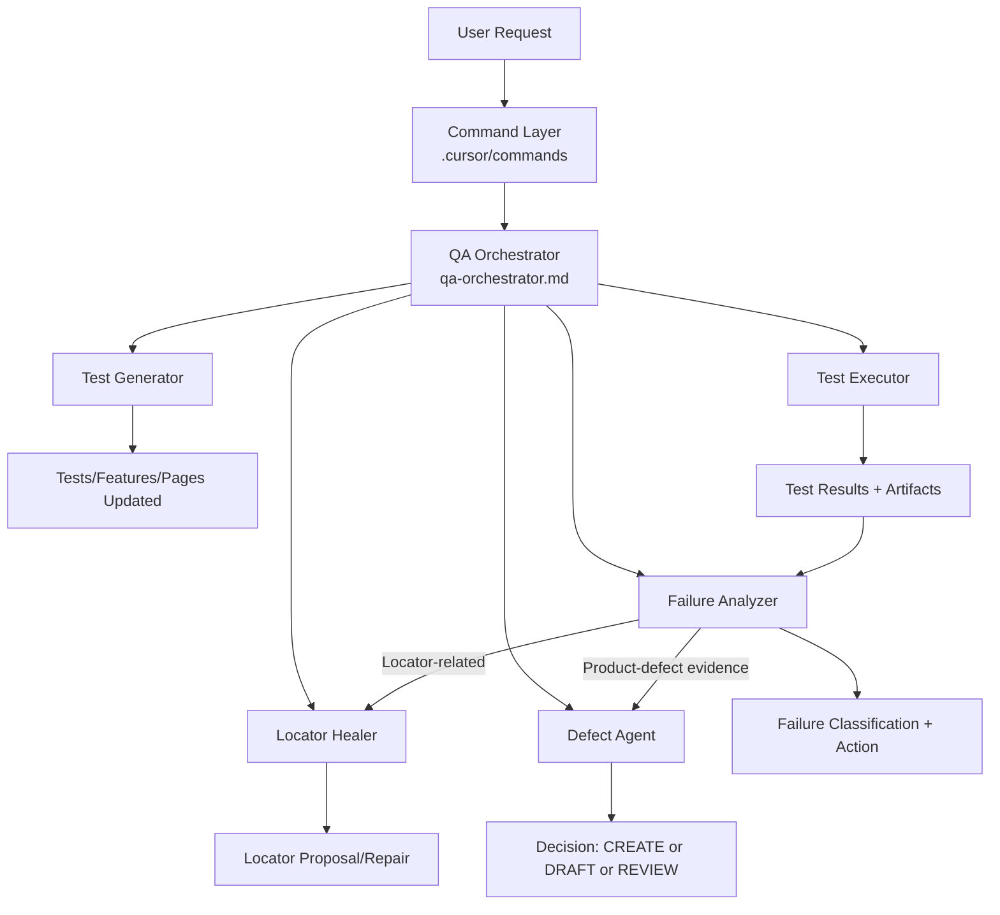

# Agent Architecture Map

This document provides a quick visual reference for the QA agent system in this repository.

## 1) Hierarchy (Top -> Bottom)

```text
User Prompt
  |
  +-- .cursor/commands/ (thin entry points)
  |     +-- /generate-test
  |     +-- /run-test
  |     +-- /analyze-failure
  |     +-- /repair-locator
  |     +-- /create-bug
  |
  +-- .cursor/agents/qa-orchestrator.md (router/coordinator)
        |
        +-- test-generator.md
        |     +-- skills: generate-test, generate-test-intent,
        |                 validate-test-intent, map-intent-to-contract
        |
        +-- test-executor.md
        |     +-- skills: run-test, run-ui-test, run-smoke-gate
        |
        +-- failure-analyzer.md
        |     +-- skill: analyze-failure
        |
        +-- locator-healer.md
        |     +-- skill: repair-locator
        |
        +-- defect-agent.md
              +-- skills: create-defect, generate-bug-draft
```

## 2) Governance Layer (Always-On Guardrails)

```text
.cursor/rules/qa-framework.mdc
.cursor/rules/security.mdc
.cursor/rules/defect-creation.mdc
.cursor/rules/playwright.mdc
.cursor/rules/test-generation.mdc
```

- Rules constrain all command, agent, and skill behavior.
- Security and defect rules are especially strict:
  - Never expose secrets.
  - Failed test does not automatically mean product bug.

## 3) Runtime and Evidence Layer

```text
Core engine: src/AgenticQa.Core/
BDD tests:   tests/AgenticQa.BddTests/
Registries:  config/ui/, config/api/
Scripts:     scripts/run-mandatory-smoke.ps1
             scripts/validate-agent-runs.ps1
Artifacts:   artifacts/results/
             artifacts/failure-analysis/
             artifacts/screenshots/
             artifacts/agent-runs/
```

## 4) Primary Routing Map

| User Intent | Command | Routed Agent | Primary Skill(s) |
|---|---|---|---|
| Generate test coverage from requirement/story | `/generate-test` | Test Generator | `generate-test` (+ intent/contract skills) |
| Run scenario/feature/smoke | `/run-test` | Test Executor | `run-test`, `run-ui-test`, `run-smoke-gate` |
| Explain failure root cause | `/analyze-failure` | Failure Analyzer | `analyze-failure` |
| Fix unstable or broken locator | `/repair-locator` | Locator Healer | `repair-locator` |
| Create bug from evidence | `/create-bug` | Defect Agent | `create-defect`, `generate-bug-draft` |

## 5) End-to-End Flow Diagram



## 6) Output Contracts (Structured Responses)

Each specialist skill returns structured output to keep triage reproducible:

- Test execution status contract (`PASSED|FAILED|BLOCKED|NOT_RUN`)
- Failure analysis contract (classification, confidence, evidence, recommendation)
- Locator repair contract (old/new locator, uniqueness, validation)
- Defect decision contract (`CREATE|DRAFT|REJECT|NEEDS_REVIEW`)

## 7) Design Intent

- Keep commands thin.
- Keep decision logic in agents + skills.
- Keep policy in rules.
- Keep evidence in artifacts.
- Prefer smallest-scope test execution and minimal code changes.
